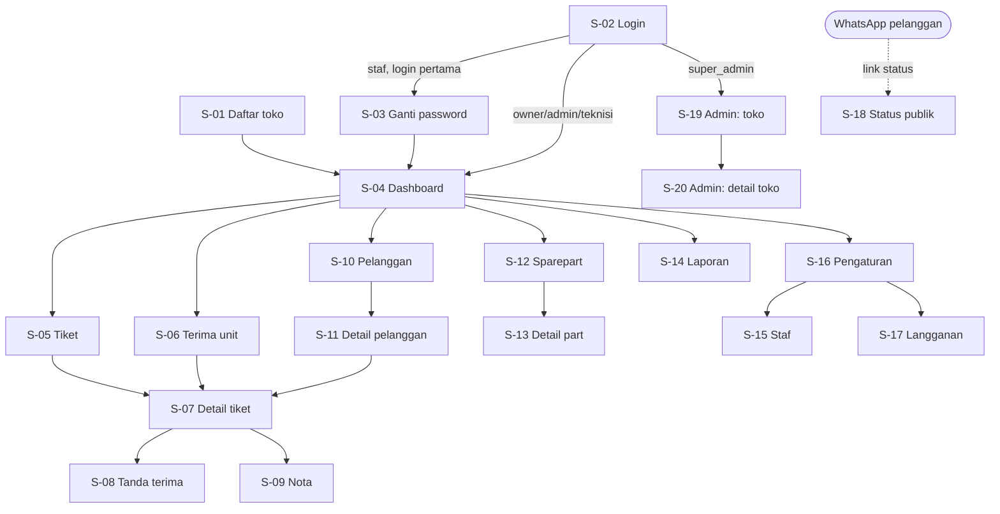
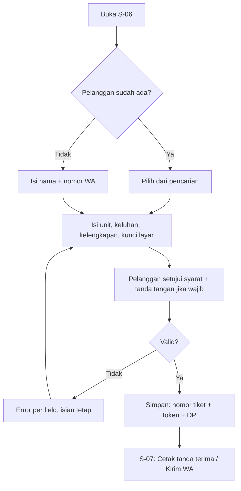
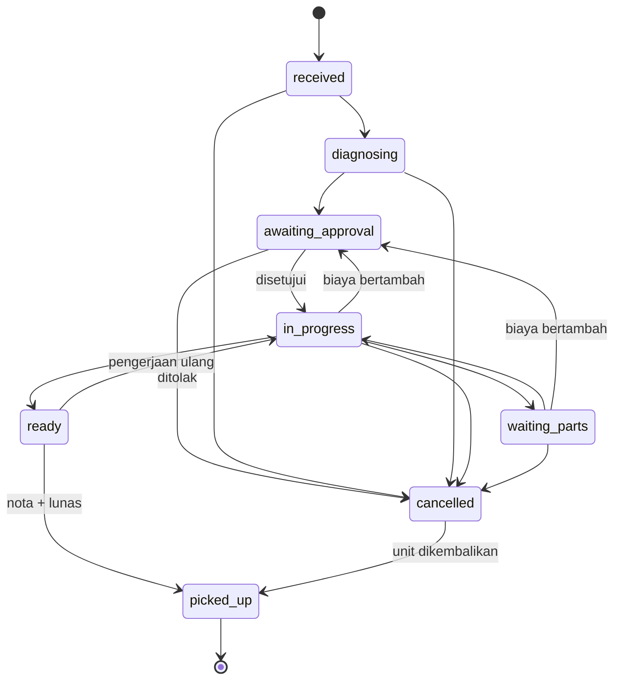
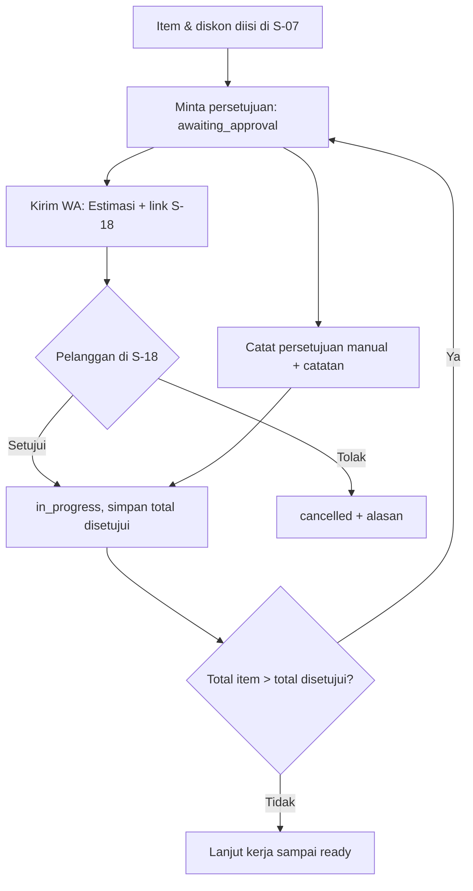
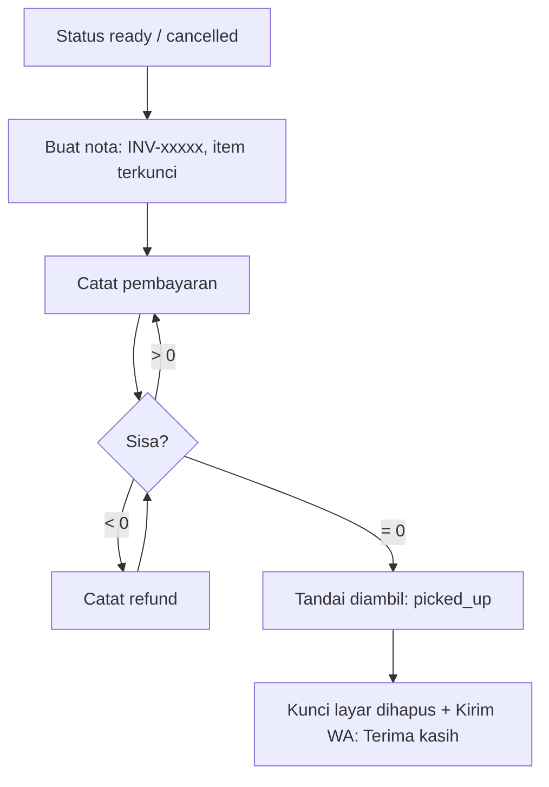

# AFD - Fixmaster

> Versi: 0.4 | Diperbarui: 2026-10-31 | Merujuk: PRD.md (ID fitur F-xx)

## 1. Peta Layar
| ID | Layar | Rute/URL | Akses | Fitur terkait |
|---|---|---|---|---|
| S-01 | Daftar toko | `/register` | Tamu | F-01 |
| S-02 | Login | `/login` | Tamu | F-01 |
| S-03 | Ganti password | `/change-password` | Semua user login | F-02 |
| S-04 | Dashboard | `/dashboard` | Owner, Admin, Teknisi | F-09 |
| S-05 | Daftar tiket | `/tickets` | Owner, Admin, Teknisi | F-04 |
| S-06 | Terima unit (tiket baru) | `/tickets/new` | Owner, Admin | F-03 |
| S-07 | Detail tiket | `/tickets/[id]` | Owner, Admin, Teknisi (milik sendiri; belum ditugaskan jika klaim aktif) | F-04, F-05, F-06, F-07, F-08 |
| S-08 | Cetak tanda terima | `/print/receipt/[id]` | Owner, Admin | F-03, F-08 |
| S-09 | Cetak nota | `/print/invoice/[id]` | Owner, Admin | F-07 |
| S-10 | Daftar pelanggan | `/customers` | Owner, Admin | F-03 |
| S-11 | Detail pelanggan | `/customers/[id]` | Owner, Admin | F-03 |
| S-12 | Daftar sparepart | `/parts` | Owner, Admin, Teknisi (baca, tanpa harga modal) | F-06 |
| S-13 | Detail part & mutasi stok | `/parts/[id]` | Owner, Admin | F-06 |
| S-14 | Laporan | `/reports` | Owner | F-09 |
| S-15 | Staf | `/settings/staff` | Owner | F-02 |
| S-16 | Pengaturan toko | `/settings` | Owner | F-10 |
| S-17 | Langganan | `/settings/subscription` | Owner | F-11 |
| S-18 | Status servis publik | `/s/[token]` | Publik (dengan token) | F-08, F-05 |
| S-19 | Admin: daftar toko | `/admin` | Super-admin | F-11 |
| S-20 | Admin: detail toko | `/admin/tenants/[id]` | Super-admin | F-11 |

## 2. Navigasi Utama
Desktop: sidebar kiri (Dashboard, Tiket, Pelanggan, Sparepart, Laporan*, Pengaturan*) + tombol utama "Terima unit". Mobile: bottom bar (Dashboard, Tiket, Terima unit, Lainnya). *Hanya owner. Item yang tidak boleh diakses peran tersebut tidak ditampilkan.

## 3. Alur per Fitur

### F-01 Registrasi toko & autentikasi
**Pemicu:** tamu membuka `/register` atau `/login`.
**Alur utama (daftar):**
1. Tamu mengisi S-01 lalu menekan "Daftar & mulai trial".
2. Sistem membuat `tenants` (nilai default BSD) + `users` owner + `accounts` dalam satu transaksi, lalu membuat sesi.
3. Redirect ke S-04 dengan state "pertama kali" (maskot + tombol "Terima unit pertama").

**Alur utama (login):** S-02 -> jika `must_change_password` ke S-03; jika `super_admin` ke S-19; selain itu ke `next` (hanya path relatif internal) atau S-04.

**Alur alternatif / gagal:**
- Email sudah terdaftar -> pesan di field email "Email sudah terdaftar".
- Email/password salah -> "Email atau password salah".
- Akun nonaktif -> "Akun Anda dinonaktifkan. Hubungi pemilik toko."
- > 5 percobaan/menit/IP -> "Terlalu banyak percobaan, coba lagi dalam 1 menit".
- Koneksi putus -> toast "Koneksi terputus, coba lagi"; isian form tetap.
- Sesi habis (halaman mana pun) -> redirect `/login?next={path}`.

### F-02 Staf & peran
**Pemicu:** owner membuka S-15.
**Alur utama:**
1. Owner menekan "Tambah staf", mengisi nama, email, peran, password sementara.
2. Sistem membuat akun dengan `must_change_password = true`; staf muncul di daftar.
3. Staf login -> S-03 -> wajib membuat password baru (min 8, beda dari sementara) -> S-04.

Aksi lain: "Nonaktifkan" (dialog konfirmasi, sesi staf dicabut), "Aktifkan", "Reset password" (dialog password sementara baru; sesi staf dicabut dan staf wajib lewat S-03 lagi). S-15 dibuka dari S-16. Semua user bisa membuka S-03 sendiri lewat menu pengguna ("Ganti password"); user yang wajib mengganti password hanya punya tombol "Keluar" sebagai jalan lain.

**Alur alternatif / gagal:**
- Email sudah dipakai -> pesan di field email.
- Owner mencoba menonaktifkan diri sendiri -> tombol tidak tersedia untuk baris owner.
- Langganan `expired` -> "Tambah staf" nonaktif dengan tautan ke S-17.

### F-03 Penerimaan unit
**Pemicu:** owner/admin menekan "Terima unit" (tersedia di semua layar aplikasi).
**Alur utama:**
1. Di S-06 cari pelanggan (nama/nomor WA) atau pilih "Pelanggan baru" (nama + nomor WA).
2. Isi unit: jenis, merek, model, IMEI/SN, keluhan, kondisi fisik, kelengkapan, kunci layar.
3. Opsional: target selesai, teknisi, DP (jumlah + metode).
4. Pelanggan membaca syarat servis (bisa dibuka), mencentang setuju, dan tanda tangan di pad (wajib jika pengaturan "Wajib tanda tangan pelanggan" aktif; jika nonaktif pad tetap ada tetapi boleh kosong).
5. Simpan -> sistem membuat pelanggan (jika baru), tiket (nomor + token), pembayaran DP (jika ada), event `created`.
6. Redirect ke S-07 dengan panel sukses: "Tiket SRV-00042 tersimpan" + "Cetak tanda terima" + "Kirim WA: Diterima".

**Alur alternatif / gagal:**
- Tanda tangan kosong saat pengaturan wajib aktif -> "Tanda tangan pelanggan wajib"; saat nonaktif -> tiket tersimpan dan tanda terima mencetak "Tanpa tanda tangan pelanggan".
- Nomor WA tidak valid -> "Nomor WA tidak valid (contoh: 0812xxxxxxxx)".
- Nomor WA pelanggan baru sudah ada -> "Nomor ini milik {nama}. Pakai pelanggan ini?" [Pakai] [Batal].
- Langganan `expired` -> S-06 menampilkan state terkunci + tautan S-17 (owner) atau "Hubungi pemilik toko" (admin).
- Koneksi putus -> toast error; isian tetap (kecuali tanda tangan bila halaman dimuat ulang).
- Sesi habis -> redirect `/login?next=/tickets/new` (isian tidak disimpan).

### F-04 Pengerjaan & status servis
**Pemicu:** staf membuka S-05 / S-07.
**Alur utama:**
1. S-05 menampilkan tab "Semua" + "Belum ditugaskan" (owner/admin), atau "Tiket saya" (teknisi; ditambah "Belum ditugaskan" jika owner mengaktifkan klaim), dengan filter status dan pencarian.
2. Di S-07, owner/admin memilih teknisi. Jika pengaturan "Teknisi boleh mengambil tiket sendiri" aktif, teknisi bisa menekan "Ambil tiket" pada tiket yang belum ditugaskan.
3. Teknisi mengubah status lewat tombol aksi yang hanya menampilkan transisi yang diizinkan (BSD bagian 4), mengisi diagnosa, dan menambah catatan.
4. "Lihat kunci layar" (owner/teknisi ditugaskan) -> dialog "Akses ini dicatat" -> nilai tampil 30 detik lalu tersembunyi lagi.

**Alur alternatif / gagal:**
- Transisi tidak diizinkan -> "Perubahan status tidak diizinkan".
- `CONFLICT` -> "Tiket sudah diubah pengguna lain. Muat ulang untuk melihat versi terbaru." + tombol Muat ulang.
- Teknisi membuka tiket milik teknisi lain -> redirect S-05 + "Anda tidak punya akses ke tiket ini".
- Membatalkan tiket -> dialog wajib isi alasan.

### F-05 Estimasi & persetujuan pelanggan
**Pemicu:** diagnosa selesai dan item biaya sudah diisi di S-07.
**Alur utama:**
1. Staf menambah item jasa/part dan diskon; total tampil otomatis.
2. Owner/admin menekan "Minta persetujuan" -> status `awaiting_approval` -> "Kirim WA: Estimasi".
3. Pelanggan membuka S-18, melihat rincian, menekan Setujui (atau Tolak + alasan opsional) -> dialog konfirmasi.
4. Sistem menyimpan total disetujui, waktu, `approval_via = link`; status `in_progress` (atau `cancelled`); event publik tercatat.
5. Alternatif: owner/admin menekan "Catat persetujuan manual" (catatan wajib) -> `approval_via = manual`.

**Alur alternatif / gagal:**
- Pelanggan menekan dua kali / membuka link lagi -> tombol hilang, tampil "Estimasi disetujui pada {tanggal}".
- Total item > total disetujui -> banner "Biaya melebihi estimasi yang disetujui (Rp X > Rp Y)"; aksi "Siap diambil" tidak tersedia; tombol "Minta persetujuan ulang".
- Tiket tidak dalam `awaiting_approval` saat pelanggan menekan -> "Estimasi ini sudah tidak menunggu persetujuan".

### F-06 Stok sparepart
**Pemicu:** owner/admin membuka S-12, atau staf menambah part di S-07.
**Alur utama:**
1. S-12: daftar part (cari nama/SKU, filter "Stok menipis") -> "Tambah part" (dialog).
2. S-13: ubah data part, "Stok masuk" (qty, harga modal/unit, catatan), "Penyesuaian" (+/-, catatan wajib), tabel riwayat mutasi.
3. Di S-07: "Tambah part dari stok" -> cari part aktif (menampilkan sisa stok) -> qty -> simpan -> stok berkurang.
4. Hapus item part -> dialog konfirmasi -> stok kembali. Tiket dibatalkan -> semua part kembali ke stok.

**Alur alternatif / gagal:**
- Stok tidak cukup -> "Stok tidak cukup (sisa N)" + tombol "Tambah sebagai part non-stok".
- SKU duplikat -> pesan di field SKU.
- Nota sudah dibuat -> tombol tambah/hapus item nonaktif dengan keterangan "Nota sudah dibuat".

### F-07 Nota & pembayaran
**Pemicu:** pelanggan membayar DP/pelunasan, atau tiket `ready`/`cancelled`.
**Alur utama:**
1. "Catat pembayaran" di S-07 (jenis, metode, jumlah, catatan) kapan saja.
2. Saat `ready`/`cancelled`: "Buat nota" -> nomor `INV-xxxxx`, item terkunci, "Cetak nota" (S-09).
3. Saat sisa = 0: "Tandai sudah diambil" (dialog konfirmasi) -> `picked_up`, kunci layar dihapus, tawarkan "Kirim WA: Terima kasih".

**Alur alternatif / gagal:**
- Sisa > 0 -> "Masih ada sisa pembayaran Rp X".
- Sisa < 0 -> "Kembalikan Rp X ke pelanggan" + tombol "Catat refund".
- Perlu ubah item setelah nota dibuat -> owner menekan "Buka kunci nota" (dialog konfirmasi, tercatat).
- Tiket `cancelled` tanpa item -> nota tidak wajib.

### F-08 Status pelanggan & WhatsApp
**Pemicu:** pelanggan membuka link dari WA atau scan QR di tanda terima; staf menekan tombol WA di S-07.
**Alur utama:**
1. S-18 memuat data tiket berdasarkan token (tanpa login) dan menampilkan bagian sesuai PRD F-08.
2. Di S-07, menu "Kirim WA" berisi 4 template (bagian 5); template yang tidak sesuai status dinonaktifkan.
3. Klik template -> sistem membuat link `wa.me` + event `wa_opened` -> tab baru WhatsApp.

**Alur alternatif / gagal:**
- Token tidak ditemukan -> 404 generik "Halaman tidak ditemukan" (tanpa menyebut tiket).
- Lewat 60 hari setelah garansi berakhir (`link_expires_at`, BSD tabel `tickets`) -> "Link sudah tidak berlaku, hubungi {nama toko}" + tombol WA toko.
- Nomor WA pelanggan tidak valid -> tombol WA nonaktif + "Perbaiki nomor WA pelanggan" (tautan S-11).

### F-09 Dashboard & laporan
**Pemicu:** login (S-04) atau owner membuka S-14.
**Alur utama:** S-04 menampilkan kartu angka (PRD F-09) yang bisa diklik menuju S-05 terfilter atau S-12 "Stok menipis". S-14: pilih rentang tanggal (preset: Hari ini, 7 hari, Bulan ini, Bulan lalu) -> tiga tabel: pendapatan, tiket selesai per teknisi, part terpakai.
**Alur alternatif / gagal:** rentang > 366 hari atau tanggal akhir < awal -> pesan di pemilih tanggal; tidak ada data -> state kosong per tabel.

### F-10 Pengaturan toko
**Pemicu:** owner membuka S-16.
**Alur utama:** ubah field -> "Simpan" -> toast "Pengaturan tersimpan". Pratinjau syarat servis dan contoh nomor tiket (`{prefix}-00001`) tampil langsung. Switch "Wajib tanda tangan pelanggan" berlaku untuk tiket baru di S-06; switch "Teknisi boleh mengambil tiket sendiri" langsung mengubah S-05 dan S-07 teknisi.
**Alur alternatif / gagal:** prefix tidak valid -> "Prefix 2-5 huruf kapital (A-Z)"; error per field.

### F-11 Langganan & super-admin
**Pemicu:** banner langganan, owner membuka S-17, atau super-admin login.
**Alur utama:**
1. Owner melihat status, harga, nominal transfer dengan kode unik toko (mis. Rp 99.123), dan rekening tujuan di S-17, lalu transfer di luar aplikasi dan mengirim bukti ke super-admin via WA.
2. Super-admin mencocokkan kode unik di S-19 -> pilih toko -> S-20 -> "Perpanjang" (tanggal aktif sampai, jumlah dibayar, catatan) -> tercatat di `subscription_logs`.
3. S-20 juga menyediakan "Reset password owner" (password sementara, owner wajib menggantinya saat login).

**Alur alternatif / gagal:** tanggal perpanjangan <= hari ini -> "Tanggal harus setelah hari ini"; super-admin dibuat hanya via `pnpm admin:create` (tidak ada form publik).

## 4. State Layar
| Layar | Kosong | Loading | Error | Sukses |
|---|---|---|---|---|
| S-01, S-02, S-03 | - | Tombol submit spinner + disabled | Pesan per field / banner di atas form | Redirect sesuai F-01/F-02 |
| S-04 | Toko baru: maskot + "Terima unit pertama" | Skeleton kartu | Kartu "Gagal memuat data" + Coba lagi | Kartu angka |
| S-05 | "Belum ada tiket" + tombol Terima unit; hasil filter kosong: "Tidak ada tiket yang cocok" + Reset filter | Skeleton 5 baris tabel | Banner + Coba lagi | Tabel/kartu tiket |
| S-06 | - | Spinner pencarian pelanggan; tombol Simpan loading | Error per field + toast | Redirect S-07 + panel sukses |
| S-07 | Item kosong: "Belum ada item biaya"; timeline selalu berisi `created` | Skeleton bagian | Tiket tidak ditemukan -> 404 aplikasi | Toast per aksi |
| S-08, S-09 | - | Teks "Menyiapkan cetakan..." | "Gagal memuat" + Tutup | Dialog cetak terbuka otomatis |
| S-10, S-11 | "Belum ada pelanggan" (pelanggan dibuat dari S-06) | Skeleton tabel | Banner + Coba lagi | Tabel / riwayat tiket |
| S-12, S-13 | "Belum ada part" + Tambah part | Skeleton tabel | Banner + Coba lagi | Tabel / riwayat mutasi |
| S-14 | Per tabel: "Tidak ada data di rentang ini" | Skeleton tabel | Banner + Coba lagi | Tabel angka + total |
| S-15 | Hanya owner: "Belum ada staf" + Tambah staf | Skeleton daftar | Banner + Coba lagi | Daftar staf |
| S-16, S-17 | - | Skeleton form | Error per field | Toast tersimpan |
| S-18 | - | Skeleton status | 404 generik / link kedaluwarsa | Status, timeline, estimasi, pembayaran |
| S-19, S-20 | "Belum ada toko" | Skeleton tabel | Banner + Coba lagi | Tabel toko / detail + log |

## 5. Aturan Lintas Layar
- Redirect setelah login: parameter `next` (hanya path internal yang diawali `/`), selain itu sesuai peran (F-01).
- Akses tanpa izin: halaman -> redirect S-04 + toast "Anda tidak punya akses ke halaman ini"; Server Action -> error `FORBIDDEN` sebagai toast.
- Langganan `expired`: banner merah di semua layar `(app)`; aksi yang diblokir (A-02) nonaktif dengan tautan ke S-17.
- Aksi berisiko memakai dialog konfirmasi: batalkan tiket, hapus item, nonaktifkan staf, buka kunci nota, tandai sudah diambil, setujui/tolak estimasi (S-18).
- Toast sukses hilang setelah 4 detik; toast error tetap tampil sampai ditutup.
- Halaman cetak (S-08, S-09) terbuka di tab baru dan memanggil dialog cetak otomatis sesuai `print_format` toko.
- Notifikasi yang dikirim sistem: tidak ada email/push. Pesan WA dikirim manual oleh staf lewat `wa.me` dengan template berikut (`{...}` diisi sistem; Rupiah diformat `Rp 150.000`):

| Template | Aktif saat status | Isi |
|---|---|---|
| Diterima | `received`, `diagnosing` | Halo {nama_pelanggan}, unit {merek} {model} Anda sudah kami terima di {nama_toko} dengan nomor servis {nomor_tiket}. Cek status kapan saja di: {link_status} |
| Estimasi | `awaiting_approval` | Halo {nama_pelanggan}, estimasi biaya servis {nomor_tiket} ({merek} {model}) adalah {total}. Mohon setujui atau tolak di: {link_status} |
| Siap diambil | `ready` | Halo {nama_pelanggan}, unit {merek} {model} ({nomor_tiket}) sudah siap diambil di {nama_toko}. Total {total}, sisa pembayaran {sisa}. Detail: {link_status} |
| Terima kasih | `picked_up` | Terima kasih, {nama_pelanggan}. Unit {nomor_tiket} sudah diambil. Garansi servis berlaku sampai {tanggal_garansi}. Detail: {link_status} (kalimat garansi dihilangkan jika `warranty_days = 0`) |
