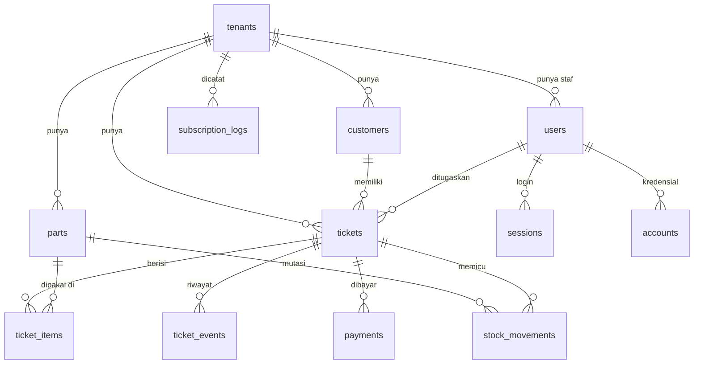

# BSD - Fixmaster

> Versi: 0.5 | Diperbarui: 2026-10-31 | Merujuk: PRD.md, TRD.md, AFD.md
> Database: Supabase Postgres (lokal via CLI, production hosted) | ORM/migrasi: Drizzle ORM + drizzle-kit (`drizzle/`)

## 1. ERD

## 2. Konvensi
- Nama tabel `snake_case` jamak; PK `uuid` (default `gen_random_uuid()`; Better Auth dikonfigurasi `generateId: "uuid"`).
- Kolom standar: `created_at`, `updated_at` (`timestamptz`, default `now()`); `updated_at` diperbarui oleh service dan dipakai untuk cek `CONFLICT`.
- Setiap tabel milik toko punya `tenant_id uuid NOT NULL` (FK `tenants`, `ON DELETE RESTRICT`) dan indeks yang diawali `tenant_id`.
- Soft delete: tidak. Users dan parts memakai `is_active`; tiket tidak pernah dihapus (status `cancelled`); pembayaran tidak bisa diubah/dihapus (koreksi lewat `refund`).
- Uang: `bigint` Rupiah bulat (tanpa desimal). Waktu: `timestamptz` UTC.
- Nomor urut per toko (`ticket_seq`, `invoice_seq`) dinaikkan dengan `UPDATE tenants SET x = x + 1 ... RETURNING` di dalam transaksi yang sama dengan insert.
- RLS: setiap tabel di schema `public`, termasuk tabel Better Auth, diaktifkan RLS tanpa policy (`.enableRLS()` di skema Drizzle) agar `anon` dan `authenticated` tidak mendapat baris apa pun. Isolasi antar toko tetap di service (bagian 5), bukan di RLS.

## 3. Tabel

### tenants
Fitur: F-01, F-10, F-11 | Tujuan: satu baris per toko (tenant).
| Kolom | Tipe | Constraint | Keterangan |
|---|---|---|---|
| id | uuid | PK | |
| name | varchar(80) | NOT NULL | Nama toko |
| phone_wa | varchar(20) | NOT NULL | Format `62xxxxxxxxx` |
| address | varchar(300) | NULL | |
| timezone | varchar(40) | NOT NULL, default `'Asia/Jakarta'`, CHECK IN (`Asia/Jakarta`,`Asia/Makassar`,`Asia/Jayapura`) | [ASUMSI A-16] |
| ticket_prefix | varchar(5) | NOT NULL, default `'SRV'`, CHECK `~ '^[A-Z]{2,5}$'` | |
| ticket_seq | integer | NOT NULL, default 0 | Nomor tiket terakhir |
| invoice_seq | integer | NOT NULL, default 0 | Nomor nota terakhir |
| default_warranty_days | integer | NOT NULL, default 30, CHECK 0-365 | [ASUMSI A-07] |
| service_terms | text | NOT NULL, default teks syarat standar | Maks 2000 karakter (validasi app) |
| print_format | print_format | NOT NULL, default `'thermal_58'` | [ASUMSI A-15] |
| require_signature | boolean | NOT NULL, default true | Tanda tangan pelanggan wajib di S-06 [ASUMSI A-05] |
| technicians_can_claim | boolean | NOT NULL, default false | Teknisi boleh mengambil tiket belum ditugaskan [ASUMSI A-13] |
| billing_code | smallint | NOT NULL, CHECK 1-999 | Acak saat registrasi; ditambahkan ke nominal transfer langganan [ASUMSI A-03] |
| trial_ends_at | timestamptz | NOT NULL | `created_at` + 14 hari [ASUMSI A-02] |
| active_until | timestamptz | NULL | Diisi super-admin |

Status langganan dihitung, tidak disimpan: `active` jika `active_until > now()`, `trial` jika `trial_ends_at > now()`, selain itu `expired`.

### users
Fitur: F-01, F-02, F-11 | Tujuan: akun login (tabel `user` Better Auth, `modelName: "users"`, dengan `additionalFields`).
| Kolom | Tipe | Constraint | Keterangan |
|---|---|---|---|
| id | uuid | PK | |
| name | varchar(100) | NOT NULL | |
| email | varchar(255) | UNIQUE, NOT NULL | Disimpan lowercase [ASUMSI A-04] |
| email_verified | boolean | NOT NULL, default false | Kolom Better Auth, tidak dipakai di MVP |
| image | text | NULL | Kolom Better Auth, tidak dipakai |
| tenant_id | uuid | FK tenants, NULL | NULL hanya untuk `super_admin` |
| role | user_role | NOT NULL | |
| is_active | boolean | NOT NULL, default true | |
| must_change_password | boolean | NOT NULL, default false | |

CHECK: `(role = 'super_admin') = (tenant_id IS NULL)`.
Indeks: `(tenant_id, role)`; UNIQUE parsial `(tenant_id) WHERE role = 'owner'` -> tepat satu owner per toko.

### sessions, accounts, verifications, rate_limits
Fitur: F-01 | Dikelola Better Auth (`usePlural`, kolom dipetakan ke `snake_case`). Jangan ditulis manual kecuali `accounts` saat membuat staf (TRD bagian 5).
- `sessions`: id, user_id (FK users, ON DELETE CASCADE), token (UNIQUE), expires_at, ip_address, user_agent, created_at, updated_at.
- `accounts`: id, user_id (FK users, CASCADE), account_id, provider_id (`credential`), password (hash), kolom OAuth bawaan (tidak dipakai), created_at, updated_at.
- `verifications`: id, identifier, value, expires_at, created_at, updated_at.
- `rate_limits`: id, key, count, last_request.

### customers
Fitur: F-03 | Tujuan: pelanggan per toko.
| Kolom | Tipe | Constraint | Keterangan |
|---|---|---|---|
| id | uuid | PK | |
| tenant_id | uuid | FK tenants, NOT NULL | |
| name | varchar(100) | NOT NULL | |
| phone_wa | varchar(20) | NOT NULL | `62xxxxxxxxx`, hasil normalisasi |
| notes | varchar(500) | NULL | |

Indeks: UNIQUE `(tenant_id, phone_wa)`; `(tenant_id, name)` untuk pencarian.
Relasi: 1 customer -> N tickets (FK `tickets.customer_id`, ON DELETE RESTRICT).

### tickets
Fitur: F-03, F-04, F-05, F-07, F-08, F-09 | Tujuan: satu unit servis dari diterima sampai diambil.
| Kolom | Tipe | Constraint | Keterangan |
|---|---|---|---|
| id | uuid | PK | |
| tenant_id | uuid | FK tenants, NOT NULL | |
| number | varchar(20) | NOT NULL | `{ticket_prefix}-{ticket_seq 5 digit}`, mis. `SRV-00042` |
| public_token | varchar(32) | UNIQUE, NOT NULL | 16 byte acak, base64url |
| customer_id | uuid | FK customers, NOT NULL | |
| status | ticket_status | NOT NULL, default `'received'` | Transisi di bagian 4 |
| assigned_to | uuid | FK users, NULL | Teknisi |
| device_type | device_type | NOT NULL | |
| brand | varchar(50) | NOT NULL | |
| model | varchar(100) | NOT NULL | |
| serial_or_imei | varchar(50) | NULL | |
| complaint | varchar(1000) | NOT NULL | Keluhan |
| condition_notes | varchar(500) | NULL | Kondisi fisik saat diterima |
| accessories | text[] | NOT NULL, default `'{}'` | Nilai dari daftar kelengkapan (bagian 4) |
| accessories_note | varchar(200) | NULL | |
| lock_type | lock_type | NOT NULL, default `'none'` | |
| lock_secret_enc | text | NULL, CHECK `lock_type <> 'none' OR lock_secret_enc IS NULL` | AES-256-GCM; di-NULL-kan saat `picked_up` |
| signature_svg | text | NULL | Maks 50 KB; wajib jika `tenants.require_signature` (validasi app) |
| terms_accepted_at | timestamptz | NOT NULL | |
| due_date | date | NULL | Target selesai |
| diagnosis | varchar(2000) | NULL | |
| discount_amount | bigint | NOT NULL, default 0, CHECK >= 0 | <= subtotal item (validasi app) |
| warranty_days | integer | NOT NULL, CHECK 0-365 | Disalin dari `tenants.default_warranty_days` saat dibuat |
| estimate_approved_total | bigint | NULL | Total saat disetujui |
| estimate_approved_at | timestamptz | NULL | |
| estimate_approval_via | approval_via | NULL | |
| cancel_reason | varchar(300) | NULL | Wajib saat `cancelled` (validasi app) |
| invoice_number | varchar(20) | NULL | `INV-{invoice_seq 5 digit}`; tetap meski nota dibuka ulang |
| invoiced_at | timestamptz | NULL | Tidak NULL = item terkunci |
| picked_up_at | timestamptz | NULL | |
| created_by | uuid | FK users, NOT NULL | |

Indeks: UNIQUE `(tenant_id, number)`; UNIQUE `(tenant_id, invoice_number)`; `(tenant_id, status, created_at DESC)`; `(tenant_id, assigned_to)`; `(tenant_id, customer_id)`; `(tenant_id, picked_up_at)` untuk laporan.
Turunan (dihitung, tidak disimpan): `subtotal = Σ qty × unit_price`; `total = subtotal − discount_amount`; `paid = Σ payment − Σ refund`; `balance = total − paid`; `warranty_until = picked_up_at + warranty_days` (tidak ada garansi untuk tiket yang dibatalkan); `link_expires_at = (warranty_until atau picked_up_at) + 60 hari` [ASUMSI A-06].

### ticket_items
Fitur: F-05, F-06, F-07 | Tujuan: baris biaya (jasa/part) yang menjadi estimasi dan nota.
| Kolom | Tipe | Constraint | Keterangan |
|---|---|---|---|
| id | uuid | PK | |
| tenant_id | uuid | FK tenants, NOT NULL | |
| ticket_id | uuid | FK tickets, NOT NULL | |
| kind | item_kind | NOT NULL | |
| part_id | uuid | FK parts, NULL, CHECK `kind = 'part' OR part_id IS NULL` | NULL pada part = part non-stok |
| description | varchar(150) | NOT NULL | Default nama part |
| qty | integer | NOT NULL, CHECK 1-99 | |
| unit_price | bigint | NOT NULL, CHECK >= 0 | Default `parts.sell_price` |
| unit_cost | bigint | NULL | Salinan `parts.cost_price` saat ditambahkan |
| created_by | uuid | FK users, NOT NULL | |

Indeks: `(ticket_id)`. Item hanya bisa ditambah/diubah/dihapus jika `invoiced_at IS NULL` dan status bukan `picked_up`.

### ticket_events
Fitur: F-04, F-05, F-07, F-08 | Tujuan: timeline dan jejak audit.
| Kolom | Tipe | Constraint | Keterangan |
|---|---|---|---|
| id | uuid | PK | |
| tenant_id | uuid | FK tenants, NOT NULL | |
| ticket_id | uuid | FK tickets, NOT NULL | |
| type | ticket_event_type | NOT NULL | |
| from_status / to_status | ticket_status | NULL | Untuk `status_changed` |
| note | varchar(1000) | NULL | |
| is_public | boolean | NOT NULL, default false | true untuk `created`, `status_changed`, `estimate_approved`, `estimate_rejected` (S-18 hanya menampilkan label status + waktu) |
| actor_id | uuid | FK users, NULL | NULL = pelanggan via link |
| created_at | timestamptz | NOT NULL, default now() | Tanpa `updated_at` (tidak bisa diubah) |

Indeks: `(ticket_id, created_at)`.

### parts
Fitur: F-06 | Tujuan: katalog sparepart dan stok saat ini.
| Kolom | Tipe | Constraint | Keterangan |
|---|---|---|---|
| id | uuid | PK | |
| tenant_id | uuid | FK tenants, NOT NULL | |
| sku | varchar(40) | NULL | |
| name | varchar(120) | NOT NULL | |
| cost_price | bigint | NOT NULL, default 0, CHECK >= 0 | Diperbarui ke `unit_cost` stok masuk terakhir |
| sell_price | bigint | NOT NULL, default 0, CHECK >= 0 | |
| stock | integer | NOT NULL, default 0, CHECK >= 0 | Selalu = Σ `stock_movements.qty_change` (diperbarui di transaksi yang sama) |
| min_stock | integer | NOT NULL, default 0, CHECK >= 0 | |
| is_active | boolean | NOT NULL, default true | |

Indeks: UNIQUE parsial `(tenant_id, sku) WHERE sku IS NOT NULL`; `(tenant_id, name)`.

### stock_movements
Fitur: F-06, F-09 | Tujuan: riwayat mutasi stok.
| Kolom | Tipe | Constraint | Keterangan |
|---|---|---|---|
| id | uuid | PK | |
| tenant_id | uuid | FK tenants, NOT NULL | |
| part_id | uuid | FK parts, NOT NULL | |
| qty_change | integer | NOT NULL, CHECK <> 0 | Negatif = keluar |
| reason | stock_reason | NOT NULL | |
| ticket_id | uuid | FK tickets, NULL, CHECK `reason NOT IN ('ticket_use','ticket_return') OR ticket_id IS NOT NULL` | |
| unit_cost | bigint | NULL | Wajib untuk `purchase` |
| note | varchar(200) | NULL | Wajib untuk `adjustment` (validasi app) |
| created_by | uuid | FK users, NOT NULL | |
| created_at | timestamptz | NOT NULL, default now() | |

Indeks: `(tenant_id, part_id, created_at DESC)`; `(tenant_id, reason, created_at)` untuk laporan.

### payments
Fitur: F-03 (DP), F-07, F-09 | Tujuan: uang masuk/keluar per tiket.
| Kolom | Tipe | Constraint | Keterangan |
|---|---|---|---|
| id | uuid | PK | |
| tenant_id | uuid | FK tenants, NOT NULL | |
| ticket_id | uuid | FK tickets, NOT NULL | |
| kind | payment_kind | NOT NULL | |
| method | payment_method | NOT NULL | |
| amount | bigint | NOT NULL, CHECK > 0 | |
| paid_at | timestamptz | NOT NULL, default now() | |
| note | varchar(200) | NULL | |
| created_by | uuid | FK users, NOT NULL | |
| created_at | timestamptz | NOT NULL, default now() | Tanpa `updated_at` (tidak bisa diubah) |

Indeks: `(tenant_id, paid_at)`; `(ticket_id)`.

### subscription_logs
Fitur: F-11 | Tujuan: jejak aksi super-admin.
| Kolom | Tipe | Constraint | Keterangan |
|---|---|---|---|
| id | uuid | PK | |
| tenant_id | uuid | FK tenants, NOT NULL | |
| action | subscription_action | NOT NULL | |
| active_until_before / active_until_after | timestamptz | NULL | |
| amount_paid | bigint | NULL | |
| note | varchar(300) | NULL | |
| actor_id | uuid | FK users, NOT NULL | Super-admin |
| created_at | timestamptz | NOT NULL, default now() | |

Indeks: `(tenant_id, created_at DESC)`.

## 4. Enum & Nilai Referensi
| Enum | Nilai | Arti |
|---|---|---|
| user_role | owner, admin, technician, super_admin | Label: Owner, Admin/Kasir, Teknisi, Super-admin |
| device_type | laptop, phone, tablet, other | Laptop, HP, Tablet, Lainnya |
| lock_type | none, pin, password, pattern | Pola disimpan sebagai urutan titik 1-9, mis. `1-2-3-6-9` |
| ticket_status | received, diagnosing, awaiting_approval, in_progress, waiting_parts, ready, picked_up, cancelled | Label & warna di DBD bagian 2 |
| approval_via | link, manual | |
| item_kind | service, part | |
| stock_reason | purchase, ticket_use, ticket_return, adjustment | |
| payment_kind | payment, refund | |
| payment_method | cash, transfer, qris, other | Tunai, Transfer, QRIS, Lainnya |
| print_format | thermal_58, thermal_80, a4 | |
| ticket_event_type | created, status_changed, assigned, diagnosis_updated, note, estimate_approved, estimate_rejected, invoice_created, invoice_reopened, payment_recorded, secret_viewed, wa_opened | |
| subscription_action | extend, reset_owner_password | |
| kelengkapan (`tickets.accessories`, bukan enum DB) | charger, cable, case, sim_card, memory_card, battery, box | Charger, Kabel data, Case/tas, Kartu SIM, Kartu memori, Baterai, Dus |

**Transisi `ticket_status`** (Teknisi* = hanya tiket yang ditugaskan kepadanya)
| Dari | Ke | Oleh | Syarat / efek |
|---|---|---|---|
| received | diagnosing | Owner, Admin, Teknisi* | - |
| diagnosing | awaiting_approval | Owner, Admin | Minimal 1 item (`NO_ITEMS`); nilai persetujuan lama dikosongkan |
| in_progress, waiting_parts | awaiting_approval | Owner, Admin | Estimasi ulang; nilai persetujuan lama dikosongkan |
| awaiting_approval | in_progress | Pelanggan (link), Owner, Admin (manual) | Isi `estimate_approved_total/at/via` = total saat itu |
| awaiting_approval | cancelled | Pelanggan (link), Owner, Admin | `cancel_reason` (pelanggan tanpa alasan -> "Estimasi ditolak pelanggan") |
| in_progress | waiting_parts | Owner, Admin, Teknisi* | - |
| waiting_parts | in_progress | Owner, Admin, Teknisi* | - |
| in_progress | ready | Owner, Admin, Teknisi* | `total <= estimate_approved_total` (`ESTIMATE_EXCEEDED`) |
| ready | in_progress | Owner, Admin, Teknisi* | `invoiced_at IS NULL` |
| received, diagnosing, in_progress, waiting_parts | cancelled | Owner, Admin | `cancel_reason` wajib |
| ready | picked_up | Owner, Admin | Nota dibuat (`INVOICE_REQUIRED`), `balance = 0` (`BALANCE_DUE`) |
| cancelled | picked_up | Owner, Admin | `balance = 0`; nota wajib jika ada item |

Efek otomatis: ke `cancelled` -> semua item part dihapus dan stoknya dikembalikan (`ticket_return`), item jasa tetap (mis. biaya pengecekan). Ke `picked_up` -> `lock_secret_enc = NULL`, `picked_up_at = now()`. Setiap transisi menulis `ticket_events` (`status_changed`, `is_public = true`).

## 5. Aturan Akses (otorisasi data)
Semua kolom Teknisi/Admin/Owner dibatasi `tenant_id` milik sesi. Akses ke data toko lain mengembalikan `NOT_FOUND` (bukan `FORBIDDEN`) agar keberadaan data tidak bocor. Setiap service wajib punya tes isolasi dua tenant.
| Tabel | Publik (token) | Teknisi | Admin | Owner | Super-admin |
|---|---|---|---|---|---|
| tenants | nama, WA, alamat toko pemilik tiket | baca profil | baca profil | baca/ubah pengaturan | baca semua; ubah `active_until` |
| users | - | baca nama staf | baca nama & peran staf | kelola staf tokonya | baca owner; reset password owner |
| customers | nama pelanggan tiket itu | baca nama & WA pada tiket yang bisa ia akses | CRUD | CRUD | - |
| tickets | subset PRD F-08 | baca: milik sendiri (+ belum ditugaskan jika `technicians_can_claim`); ubah: milik sendiri | CRUD (tidak bisa membuka kunci layar) | CRUD + buka kunci layar | jumlah tiket per toko |
| tickets.lock_secret_enc | - | buka jika ditugaskan | tulis saat terima unit | buka | - |
| ticket_items | baca | CRUD pada tiket miliknya (sebelum nota) | CRUD (sebelum nota) | CRUD + buka kunci nota | - |
| ticket_events | baca `is_public` | baca & tambah catatan (tiket miliknya) | baca & tambah catatan | baca & tambah catatan | - |
| payments | ringkasan total/dibayar/sisa | - | tambah & baca | tambah & baca | - |
| parts | - | baca tanpa `cost_price` | CRUD | CRUD | - |
| stock_movements | - | otomatis via item tiket | baca; tambah `purchase`/`adjustment` | sama dengan Admin | - |
| subscription_logs | - | - | - | baca milik tokonya | tambah & baca |

## 6. Kontrak API Ringkas
Route Handler: `GET|POST /api/auth/[...all]` (Better Auth: sign-in, sign-out, sesi; respons error sign-in: 401 `INVALID_EMAIL_OR_PASSWORD`, 403 `ACCOUNT_DISABLED`, 429), `GET /manifest.webmanifest`. Selain itu semua mutasi adalah **Server Action** di `src/server/actions/`, yang mengembalikan `ActionResult<T>`. Teknisi* = hanya tiket yang ditugaskan.
| Server Action | Peran | Input | Sukses | Error |
|---|---|---|---|---|
| registerShop | Tamu | `{ shopName, ownerName, phoneWa, email, password }` | sesi + redirect `/dashboard` | VALIDATION, EMAIL_TAKEN |
| changePassword | Semua | `{ currentPassword, newPassword }` | `{}` | VALIDATION, INVALID_PASSWORD |
| createStaff | Owner | `{ name, email, role, tempPassword }` | `{ userId }` | VALIDATION, EMAIL_TAKEN, SUBSCRIPTION_EXPIRED |
| setStaffActive | Owner | `{ userId, isActive }` | `{}` | NOT_FOUND, CANNOT_DEACTIVATE_SELF |
| resetStaffPassword | Owner | `{ userId, tempPassword }` | `{}` | NOT_FOUND, VALIDATION |
| searchCustomers | Owner, Admin | `{ q }` (min 3 karakter) | `{ items }` (maks 10) | VALIDATION |
| saveCustomer | Owner, Admin | `{ id?, name, phoneWa, notes? }` | `{ customerId }` | VALIDATION, PHONE_TAKEN |
| createTicket | Owner, Admin | `{ customerId \| newCustomer, deviceType, brand, model, serialOrImei?, complaint, conditionNotes?, accessories, accessoriesNote?, lockType, lockSecret?, dueDate?, assignedTo?, downPayment?, signatureSvg?, termsAccepted }` | `{ ticketId, number }` | VALIDATION, PHONE_TAKEN, SUBSCRIPTION_EXPIRED |
| assignTicket | Owner, Admin | `{ ticketId, userId \| null, updatedAt }` | `{}` | NOT_FOUND, CONFLICT |
| claimTicket | Teknisi (jika `technicians_can_claim`) | `{ ticketId, updatedAt }` | `{}` | NOT_FOUND, CLAIM_DISABLED, ALREADY_ASSIGNED, CONFLICT |
| changeStatus | Sesuai bagian 4 | `{ ticketId, to, note?, cancelReason?, updatedAt }` | `{ status }` | INVALID_TRANSITION, FORBIDDEN, CONFLICT, NO_ITEMS, ESTIMATE_EXCEEDED, INVOICE_REQUIRED, BALANCE_DUE |
| recordManualApproval | Owner, Admin | `{ ticketId, decision: 'approve' \| 'reject', note, updatedAt }` | `{ status }` | INVALID_TRANSITION, CONFLICT |
| respondEstimate | Publik | `{ token, decision, reason? }` | `{ status }` | NOT_FOUND, NOT_AWAITING |
| updateDiagnosis | Owner, Admin, Teknisi* | `{ ticketId, diagnosis, updatedAt }` | `{}` | CONFLICT, VALIDATION |
| addNote | Owner, Admin, Teknisi* | `{ ticketId, note }` | `{ eventId }` | VALIDATION |
| revealLockSecret | Owner, Teknisi* | `{ ticketId }` | `{ lockType, secret }` | FORBIDDEN, NOT_FOUND |
| addItem / updateItem / removeItem | Owner, Admin, Teknisi* | `{ ticketId, kind, partId?, description, qty, unitPrice }` / `{ itemId, ... }` / `{ itemId }` | `{ itemId }` / `{}` | ITEMS_LOCKED, INSUFFICIENT_STOCK, VALIDATION |
| setDiscount | Owner, Admin | `{ ticketId, discountAmount }` | `{}` | ITEMS_LOCKED, DISCOUNT_TOO_LARGE |
| recordPayment | Owner, Admin | `{ ticketId, kind, method, amount, note? }` | `{ paymentId, balance }` | VALIDATION |
| createInvoice | Owner, Admin | `{ ticketId }` | `{ invoiceNumber }` | INVALID_STATUS, ESTIMATE_EXCEEDED |
| reopenInvoice | Owner | `{ ticketId, reason }` | `{}` | INVALID_STATUS |
| buildWaLink | Owner, Admin | `{ ticketId, template: 'received' \| 'estimate' \| 'ready' \| 'thanks' }` | `{ url }` | TEMPLATE_NOT_AVAILABLE, INVALID_PHONE |
| savePart | Owner, Admin | `{ id?, sku?, name, costPrice, sellPrice, minStock, isActive }` | `{ partId }` | VALIDATION, SKU_TAKEN, SUBSCRIPTION_EXPIRED (part baru) |
| stockIn | Owner, Admin | `{ partId, qty, unitCost, note? }` | `{ stock }` | VALIDATION |
| adjustStock | Owner, Admin | `{ partId, qtyChange, note }` | `{ stock }` | VALIDATION, INSUFFICIENT_STOCK |
| updateSettings | Owner | `{ name, address?, phoneWa, timezone, ticketPrefix, defaultWarrantyDays, serviceTerms, printFormat, requireSignature, techniciansCanClaim }` | `{}` | VALIDATION |
| extendSubscription | Super-admin | `{ tenantId, activeUntil, amountPaid?, note? }` | `{ activeUntil }` | VALIDATION, DATE_NOT_FUTURE |
| resetOwnerPassword | Super-admin | `{ tenantId, tempPassword }` | `{}` | NOT_FOUND, VALIDATION |

Efek aksi staf: `createStaff` dan `resetStaffPassword` mengisi `must_change_password = true`; `resetStaffPassword` dan `setStaffActive` (saat menonaktifkan) menghapus semua `sessions` staf itu; `resetStaffPassword` pada baris owner -> `NOT_FOUND`; `changePassword` mengosongkan `must_change_password`.

Data baca (dashboard, laporan, daftar) dipanggil langsung dari Server Component lewat service, dengan aturan akses yang sama.
Kode error umum: `UNAUTHENTICATED`, `FORBIDDEN`, `NOT_FOUND`, `VALIDATION`, `CONFLICT`, `SUBSCRIPTION_EXPIRED`, `RATE_LIMITED`, `INTERNAL`.
Format error standar: `{ "ok": false, "error": { "code": "INSUFFICIENT_STOCK", "message": "Stok tidak cukup (sisa 2)", "fields": { "qty": "..." } } }`

## 7. Migrasi & Seed
- Urutan migrasi: enum -> `tenants` -> `users` + tabel Better Auth -> `customers` -> `parts` -> `tickets` -> `ticket_items` -> `ticket_events` -> `payments` -> `stock_movements` -> `subscription_logs`.
- Migrasi dibuat dengan `pnpm db:generate` (drizzle-kit) dan dijalankan dengan `pnpm db:migrate` (lokal: `DATABASE_URL` ke Supabase lokal; production: `DIRECT_URL`). File di `drizzle/` tidak boleh diubah setelah di-commit; perubahan = migrasi baru. Folder `supabase/migrations/` tidak dipakai.
- Data seed (dev, `pnpm db:seed`, deterministik; hanya berjalan terhadap Postgres lokal, TRD bagian 5; database yang sudah berisi data dibiarkan apa adanya, jalankan `pnpm db:reset` dulu):
  - Toko "Toko Demo Servis" (prefix `SRV`, trial aktif) dengan `owner@demo.test`, `admin@demo.test`, `teknisi@demo.test`, `teknisi2@demo.test` (password `password123`, hanya dev).
  - 8 pelanggan, 10 part (2 di bawah stok minimum), 12 tiket mencakup kedelapan status lengkap dengan item, pembayaran, dan event.
  - Toko kedua "Toko Lain" dengan `owner@lain.test`, `teknisi@lain.test`, dan 2 tiket (untuk uji isolasi), memakai `require_signature = false` dan `technicians_can_claim = true` agar kedua mode pengaturan teruji. Token status tiket seed tetap: `demo-status-token-0001` dst. dan `lain-status-token-0001` dst.
  - Super-admin `admin@fixmaster.test`.

## 8. Kebijakan Data
- Retensi: data tiket, pelanggan, dan pembayaran disimpan selama toko terdaftar. Penghapusan toko dilakukan manual oleh super-admin atas permintaan owner (tidak ada fitur UI di MVP).
- Data sensitif/PII: `customers.name`, `customers.phone_wa`, `tickets.serial_or_imei` (S-18 hanya 4 karakter akhir), `tickets.signature_svg`, `tickets.lock_secret_enc` (terenkripsi, dihapus saat `picked_up`), `users.email`. Tidak boleh muncul di log.
- Backup: production memakai backup Supabase sesuai tier (tier Free: lihat risiko TRD bagian 9); data di Supabase lokal adalah data uji [ASUMSI A-11].
